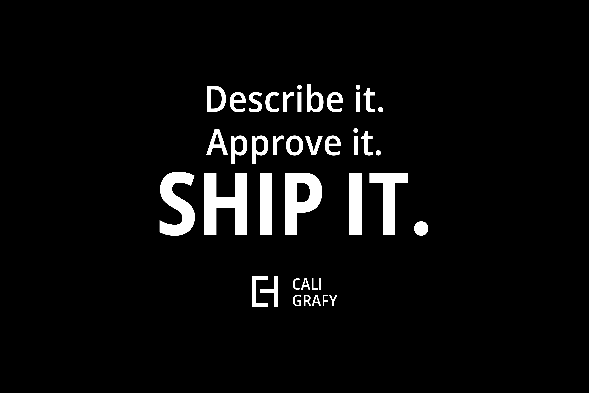

# Caligrafy - Describe it. Approve it. Ship it.


**Your idea turned into a complete app.** Describe it to [Claude Code](https://claude.com/claude-code), approve the
plan, and Caligrafy ships it online, with the code in your own GitHub repository. Or write it yourself: everything
Claude writes is plain Caligrafy, documented step by step.

**Why developers choose it.** A feature is written once, as a capability, and served to pages, Vue apps, REST, AI agents over MCP
and Snap Cards, with the same rules and audit log everywhere. The same app takes 471 lines in Caligrafy against 708 in Laravel
and 1,076 in Symfony, 7 of 8 security defaults need no code, and a new project installs 16.6 MB. See
[why Caligrafy](https://github.com/caligrafy/caligrafy-quill/wiki/Why-Caligrafy): the benefits, the measurements, and what it is not yet.

<br/>

## With Claude

```bash
git clone https://github.com/caligrafy/caligrafy-quill.git myapp
cd myapp
claude
```
```
/caligrafy-quill:idea A reading list: I add books I want to read, mark them as read, and rate them from 1 to 5.
```

| | You | Claude and Caligrafy |
| --- | --- | --- |
| **1. Describe it** | your idea, in a sentence | a plan: the tables, every feature, who may do what, the pages |
| **2. Approve it** | read the plan, change it, say OK | build every feature once and check it |
| **3. Ship it** | approve the sign-ins in your browser | your GitHub repository, online at `https://<name>.caligrafy.com` |

Claude never asks for a password or a key, and asks before spending credits.
[Quickstart with Claude](https://github.com/caligrafy/caligrafy-quill/wiki/Quickstart-with-Claude) has the details.

**Start from a proven prompt** on the [marketplace](https://caligrafy.com/marketplace), and sell yours there once it is
online (`/caligrafy-quill:marketplace`, 25% of every sale).

<br/>

## By hand

You need Git and Docker Desktop (running):
```bash
git clone https://github.com/caligrafy/caligrafy-quill.git myapp
cd myapp
.bin/caligrafer quickstart --docker --example
```
Open http://localhost:8080/tasks. The [Quickstart](https://github.com/caligrafy/caligrafy-quill/wiki/Quickstart) then
takes you through the same app over REST and from an AI agent, and puts it online with `php caligrafer.php cloud deploy`.

A feature, by hand, is four small pieces:

| Piece | File | Example |
| --- | --- | --- |
| A table | `application/models/Bookshelf/create_db.sql` | `CREATE TABLE IF NOT EXISTS books (...)`, run with `php caligrafer.php sql application/models/Bookshelf/create_db.sql` (a later change: `php caligrafer.php migrate make <name>`) |
| A model | `application/models/Bookshelf/Book.php` | `class Book extends Model { public $id; public $title; ... }`, one property per column |
| A capability | `application/services/` | `#[Capability(name: 'list_books', readOnly: true)]` with `Book::with('author')->paginate(20)` |
| Its routes | `application/config/routing/web.php` | `Route::page('/books', 'Books/index', ['data' => ['books' => 'list_books']])` |

The same capability is then a REST endpoint (`Route::capabilities()`), a tool for AI agents (`Route::mcp()`) and a
function of the generated JavaScript client. Forms, sign-in, webhooks and downloads (CSV, JSON or many files as one ZIP) are one route each
(`Route::form`, `Route::auth`, `Route::webhook`, `Route::download`), and `Route::action` answers whatever a page or a form
cannot say. Every request is declared: an application needs no controller.
[Your first capability](https://github.com/caligrafy/caligrafy-quill/wiki/Your-First-Capability) builds one, page
included.

<br/>

## A complete app

Every feature is written once, as a **capability** (its inputs, rules and permissions), and served everywhere:
**web pages**, **Vue apps** on desktop, tablet and phone, **iOS and Android apps** for the App Store and Google Play
([phone and tablet apps](https://github.com/caligrafy/caligrafy-quill/wiki/9.9.7-Phone-and-Tablet-Apps): `php caligrafer.php
mobile`, signed in through your site), a **REST API**, **AI agents** such as Claude or Cursor over MCP, and
**Snap Cards** with an assistant: `Route::snap();` turns every capability into a card a person can use,
shown with card views in your app's own look (Claude writes them from your pages), and gives them a Home that shows what needs them and an assistant that answers with those cards
([Snap Cards and the assistant](https://github.com/caligrafy/caligrafy-quill/wiki/Snap-Cards-and-the-Assistant)).
Same rules, same permissions, same audit log, whichever way it is called. A capability can also run on a
timer ([scheduled jobs](https://github.com/caligrafy/caligrafy-quill/wiki/Scheduled-Jobs)), reach your users with the
app closed ([notifications](https://github.com/caligrafy/caligrafy-quill/wiki/Notifications): web push, phones and email), or
run later, outside the request ([background jobs](https://github.com/caligrafy/caligrafy-quill/wiki/Background-Jobs),
with retries).

| | |
| --- | --- |
| **Data** | [models](https://github.com/caligrafy/caligrafy-quill/wiki/4.-Models), [queries](https://github.com/caligrafy/caligrafy-quill/wiki/Queries) (filters, paging, related rows, every value bound), [migrations](https://github.com/caligrafy/caligrafy-quill/wiki/Migrations), [the cache](https://github.com/caligrafy/caligrafy-quill/wiki/Caching) |
| **Pages** | [Pug views and page components](https://github.com/caligrafy/caligrafy-quill/wiki/7.-Views), [declarative routes](https://github.com/caligrafy/caligrafy-quill/wiki/Declarative-Routes), [design styles](https://github.com/caligrafy/caligrafy-quill/wiki/Design-Styles), install to home screen |
| **Assistant** | [Snap Cards](https://github.com/caligrafy/caligrafy-quill/wiki/Snap-Cards-and-the-Assistant): every capability as a card (Ask, Show, Go, Track, Offer) in your app's own look (card views written from your pages), a Home that orchestrates what needs you, an assistant (Claude) that keeps the conversation's context; changes only from a Confirm |
| **People** | [sign-in with a username or an email, passkeys, permissions and tokens](https://github.com/caligrafy/caligrafy-quill/wiki/9.1-Authentication) |
| **In the box** | [payments](https://github.com/caligrafy/caligrafy-quill/wiki/9.2-Stripe-&-Cryptocurrency-Payment), AI (OpenAI, open models, Watson), face detection, machine learning, [social cards](https://github.com/caligrafy/caligrafy-quill/wiki/9.3-Metadata-&-Social-Rich-Cards), a production `Dockerfile` |
| **Production** | a [production image](https://github.com/caligrafy/caligrafy-quill/wiki/Performance-and-Deployment) that sizes itself to its container, keeps database connections, preloads the framework and keeps public answers in memory; an experimental async server for the API and AI agents; a 15 MB install, with each optional SDK added by `php caligrafer.php add <feature>` |
| **Security by default** | [CSRF, bound queries, inputs, passwords, sessions, token scopes and N+1 prevention](https://github.com/caligrafy/caligrafy-quill/wiki/Security-Defaults) with no code |
| **Quality** | [tests](https://github.com/caligrafy/caligrafy-quill/wiki/Testing-Your-App) that call capabilities the way every channel does, `php caligrafer.php doctor` |

See [How Caligrafy works](https://github.com/caligrafy/caligrafy-quill/wiki/How-Caligrafy-Works).

**Fast and small.** On the same benchmark machine (2 CPUs), Caligrafy 2.26 answers 7,998 HTML pages a second, against
4,182 for Nuxt, 1,135 for Next.js, 1,830 for Symfony and 266 for Laravel; it is faster than Next.js on every test, and
its experimental async server answers capability calls at 113,700 a second. A new project installs 13 packages and
16.6 MB, and a container uses about 35 MB
([release notes](https://github.com/caligrafy/caligrafy-quill/wiki/Release-notes:-2.26.0)).

<br/>

## Learn

| If you want to | Read |
| --- | --- |
| Know why to choose it | [Why Caligrafy](https://github.com/caligrafy/caligrafy-quill/wiki/Why-Caligrafy): benefits, measurements, and what it is not yet |
| See everything Caligrafy does | [The documentation](https://github.com/caligrafy/caligrafy-quill/wiki/) |
| Learn step by step, with Claude or by hand | [The Caligrafy course](https://github.com/caligrafy/caligrafy-quill-course) |
| Build a feature | [Your first capability](https://github.com/caligrafy/caligrafy-quill/wiki/Your-First-Capability) |
| Every command | [Caligrafer](https://github.com/caligrafy/caligrafy-quill/wiki/Caligrafer) |
| Put it online | [Putting it online](https://github.com/caligrafy/caligrafy-quill/wiki/Putting-it-Online): Caligrafy Cloud or your own server |
| Give the docs to a coding agent (Cursor, Codex, Copilot, Gemini) | [AGENTS.md](AGENTS.md), [llms.txt](https://github.com/caligrafy/caligrafy-quill/blob/master/llms.txt) and [llms-full.txt](https://github.com/caligrafy/caligrafy-quill/blob/master/llms-full.txt): every wiki page in one file |
| See what changed | [Changelog](CHANGELOG.md) |
| Contribute | [Contributing](CONTRIBUTING.md) and [how the framework is built](ARCHITECTURE.md) |

<br/>

## Community and support

+ **GitHub:** [issues](https://github.com/caligrafy/caligrafy-quill/issues) for bugs and feature requests.
+ **Slack:** [join the Caligrafy community](https://join.slack.com/t/caligrafy/shared_invite/enQtNzI4MDY2OTA4MTgzLTI2NDc2NTVmMDNlMWQ5YWYxN2RjZTkwZjdiNjM5ZTg3NjQ2YWYyMzRmZDgzNWE0Nzc4YjQyODM2NDNkNjQ2OTU) to get help and share what you build.
+ **Facebook:** the [Caligrafy group](https://www.facebook.com/groups/caligrafy/).
+ **Videos:** the [Caligrafy channel](https://www.youtube.com/playlist?list=PLsJG81fLk3_VWmXl9DnEldYY9ei4jTCjA).

If Caligrafy helps you, [sponsor it on GitHub](https://github.com/sponsors/DoryAzar) or share
[caligrafy.com](https://caligrafy.com).

<br/>

Caligrafy is released under the [MIT License](LICENSE).
