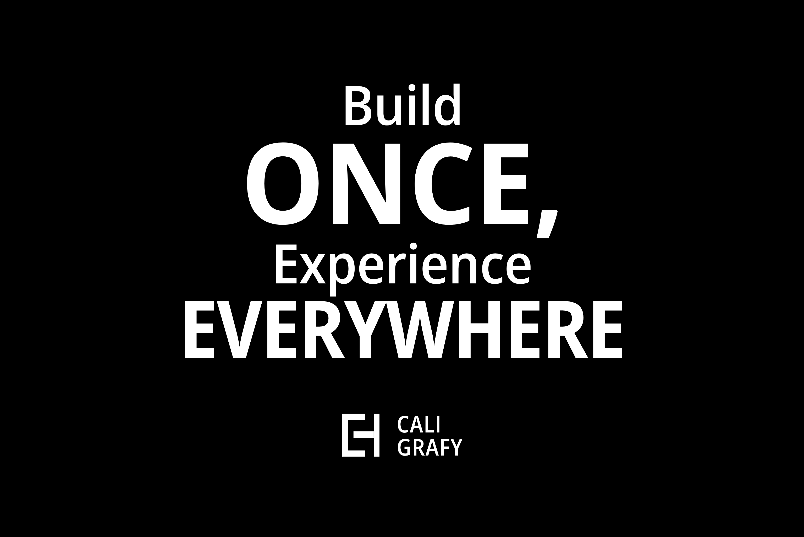

# caligrafy-quill - Claude Code plugin



Gives Claude Code full knowledge of [Caligrafy Quill](https://github.com/caligrafy/caligrafy-quill), the "Build Once, Experience Everywhere" framework: Claude writes a feature once as a capability and serves it to web pages, Vue apps, REST and AI agents.

| Component | Name | What it does |
| - | - | - |
| Skill (auto) | `caligrafy` | Index of the complete Caligrafy wiki (all 49 pages in `skills/caligrafy/reference/`), UI guidelines for every new page, a source-verified API reference and a list of verified gotchas/wiki errata (G1-G91) and end-to-end recipes (OpenAI/Groq chat apps, face login). Loads whenever Claude works in a Quill project |
| Skill | `/caligrafy-quill:new-resource <Entity> [field:type ...]` | SQL `create_db.sql` + Model + the CRUD capabilities + REST routes + pages with `Route::page` (no controller on the model) |
| Skill | `/caligrafy-quill:idea <your idea>` | The Quickstart with Claude: from an idea to an application online, with one confirmation. Plans it with the user, builds every feature once (tables, capabilities, sign-in, a page, REST, MCP and a token page for agents), checks every experience, then ships it with the `ship` skill |
| Skill | `/caligrafy-quill:ship [app-name] [--public]` | Puts the project online without handing work to the user: commits, creates the GitHub repository and pushes (SSH first, then HTTPS, then a browser approval of the GitHub CLI), signs in to Caligrafy Cloud by a browser approval, creates the app, adds its deploy key, deploys and checks it. Asks only before spending credits (`scripts/github.sh`) |
| Skill | `/caligrafy-quill:new-capability <name> [scope]` | A capability written once (service + `#[Capability]`) and served to Pug pages, REST, the JS client and AI agents over MCP, with a token and a check of every channel |
| Skill | `/caligrafy-quill:new-app <app\|create\|bot\|facedetect\|ml> <name>` | Scaffolds a client app with caligrafer and wires its page and data routes |
| Skill | `/caligrafy-quill:server <start\|stop\|status>` | Docker dev server via `.bin/caligrafer`, with port-clash and `.env` checks, and troubleshooting (port overrides, corporate TLS proxies) |
| Skill | `/caligrafy-quill:db <script.sql\|tables\|query "...">` | Runs SQL scripts in the `mysql` container (or local MySQL), with safety checks for destructive scripts |
| Skill | `/caligrafy-quill:deploy [app-name] [--own-server]` | Puts the project online: checks it is ready (Dockerfile, `composer.lock`, no secrets in git, `create_db.sql` safe to run again, pushed), then deploys it to Caligrafy Cloud (`https://<name>.caligrafy.com`) or prepares it for Coolify or Docker |
| Agent | `caligrafy-reviewer` | Reviews Caligrafy code against the framework's real behavior |
| Hook | PostToolUse `php -l` | Syntax-checks every `.php` file Claude writes or edits (skipped when PHP is not installed) |

## Install

It installs itself: the Quill repository ships `.claude/settings.json`, which registers this folder's marketplace
(`.claude-plugin/marketplace.json` at the repo root) and enables `caligrafy-quill@caligrafy`. Open the project in
Claude Code and accept the folder trust prompt.

Manual install from GitHub:
```
/plugin marketplace add caligrafy/caligrafy-quill
/plugin install caligrafy-quill@caligrafy
```
or from a shell: `claude plugin marketplace add caligrafy/caligrafy-quill && claude plugin install caligrafy-quill@caligrafy`.

Local development: `claude --plugin-dir ./claude-plugin`, and `claude plugin validate ./claude-plugin --strict`.

## Updating the knowledge

The files in `skills/caligrafy/reference/0*.md`, `1*.md` and `wiki-sidebar.md` mirror the wiki
(https://github.com/caligrafy/caligrafy-quill/wiki) with a source link at the top of each. Refresh them from a wiki clone:
```
git clone https://github.com/caligrafy/caligrafy-quill.wiki.git ../caligrafy-quill.wiki
python3 claude-plugin/scripts/sync-wiki.py ../caligrafy-quill.wiki            # rewrite the mirrors
python3 claude-plugin/scripts/sync-wiki.py ../caligrafy-quill.wiki --check    # exit 1 when a mirror is stale
```
The script keeps each mirror's "Verified against framework source" note. `api-reference.md` and `gotchas.md` are
written from the framework source: update them when `framework/` changes (and run `./qa/run.sh`), then bump
`version` in `.claude-plugin/plugin.json`.

## Changelog
- **1.19.1** - Caligrafy Quill 2.7.1: `Tokens::create()` takes the expiry as a Unix time (`Tokens::expiresAt()`,
  G91) in the API reference and the `idea` skill's token page; gotchas G1-G91.
- **1.19.0** - Caligrafy Quill 2.7.0, from an idea to online without hand-offs: the new `ship` skill and its
  `scripts/github.sh` (publish, push, deploy-key, login: SSH, then HTTPS with the GitHub CLI, then its browser
  approval, opened for the user); `idea` asks once, at the plan, and ships by itself; `deploy` points to `ship` and the
  browser-approved `cloud login`; pages call their routes with `apiHeaders()` in the recipes, `caligrafy` and
  `new-app` (G1, G27 updated); gotchas G87 (pages and the key that is off online), G88 (`cloud login` approved in the
  browser), G89 (a pipe hides the exit code), G90 (30 free minutes per new app, the deploy key file); reviewer check 3
  flags `'Bearer ' + apiKey` in pages.
- **1.18.0** - Caligrafy Quill 2.6.0: the quickstart from Composer on MAMP, XAMPP, LAMP or Docker (`composer
  create-project`, `created`, the launcher's choice of server, local addresses and MySQL settings) in the `server` skill,
  the API reference and the wiki mirrors; G86 (a local server's real web folder and ports, a Docker MySQL holding 3306).
- **1.17.1** - `ARCHITECTURE.md` rewritten for Caligrafy Quill 2.5.0 (the request lifecycle, `Capabilities::call`, the
  `Context`, each experience's adapter, the user capabilities, data and deployment, the design decisions); the
  `caligrafy` skill points to it for questions about how the framework itself is built.
- **1.17.0** - Caligrafy Quill 2.5.0, only capabilities touch models: `Route::page` and the page controller in the API
  reference, the main skill (map row, CRUD recipe and conventions capabilities-first) and the UI guidelines; the user
  capabilities (`list_users`, `get_user`, `update_user`, `delete_user`, `register_user`, `CaligrafyUsers::ADMIN_LEVEL`)
  and the controllers on them; error codes 1005 and 1006; `/caligrafy-quill:new-resource` rewritten capabilities-first
  (no controller on the model); `idea` and `new-capability` build pages with `Route::page`; G74 updated, gotchas
  G80-G85 (upgrade holds the user capabilities, `register_user` web and cli only, `ADMIN_LEVEL`, `Route::page` data and
  `notFound`, auth for `signedIn`/`level`, the legacy key and ownerless tokens never manage users); reviewer check 20; wiki mirrors, including the 2.5.0 release notes.
- **1.16.1** - What building an application with `/caligrafy-quill:idea` showed: gotchas G74-G79 (views on closure
  routes need `authorized` passed, sign-up usernames are letters and digits only, `service` without `--scope` writes
  an empty scope, `token revoke` takes the bare number, `quickstart` prints port 8080 even when remapped, tokens for an
  application online come from a page); the `idea`, `new-capability` and `server` skills refer to them; reviewer
  check 19 for applications built from an idea and put online.
- **1.16.0** - The Quickstart with Claude: the new `/caligrafy-quill:idea` skill takes an idea to an application
  online (plan, tables, capabilities, sign-in, a page on the page components, REST, MCP and a token page so agents
  can use the app online, checks of every experience, GitHub, Caligrafy Cloud); the `caligrafy` skill points to it;
  wiki mirrors, including Quickstart with Claude.
- **1.15.0** - Caligrafy Quill 2.4.0, putting a project online: the new `/caligrafy-quill:deploy` skill (readiness
  checks, then Caligrafy Cloud or an own server); `php caligrafer.php deploy` and `cloud` in the API reference and the
  `caligrafy` skill; gotchas G67-G73 (`.env` as a file only, `create_db.sql` run again when changed, `composer.lock`,
  sessions and uploads volumes, MySQL 8.4 memory, `cloud login` in a terminal, Stripe Managed Payments tax codes);
  G60 and the UI guidelines follow the page components' sign-in look; wiki mirrors, including Putting it online and
  the 2.4.0 release notes.
- **1.14.0** - Caligrafy Quill 2.3.0: `php caligrafer.php call` (try a capability in one line) in the API reference,
  the `caligrafy` skill and `new-capability`; the new `upgrade` reports (settings, Bootstrap 3) and `--keep`, the
  doctor warnings (`APP_DEBUG` over HTTPS, `CRYPTO_PAY_KEY`) and `DB_TIMEZONE`; G61, G62 and G65 updated for the
  fixes; the `new-app` skill knows the app template uses the JS client; wiki mirrors, including the 2.3.0 release notes.
- **1.13.2** - The `npm install` vulnerabilities of Vite apps (G66): the `minimatch` override that the template now
  has, and the warning never to run `npm audit fix --force`; the `new-app` skill and the wiki mirror of 9.8.1.
- **1.13.1** - What building the Caligrafy course on 2.2.0 uncovered: one card per page (`ui-guidelines.md`, G61); the
  `new-app` skill now builds Vue apps and the Vite SPA on the generated JS client instead of the template's axios +
  shared key (refused once `LEGACY_API_KEY=false`), with the SPA's dev proxy for `/capabilities`, hash history and
  `<router-view :key="$route.fullPath">` (G63), and says that `caligrafer create` in Docker does not install the
  packages (G62); `fetch()` versus `parameters()` in controllers (G64) and audit versus MySQL times (G65); the skill
  map points to the Caligrafy course; wiki mirrors of Views, SPA routing and Getting Started.
- **1.13.0** - Caligrafy Quill 2.2.0: `.bin/caligrafer quickstart` (one command from a fresh project to a working
  build-once application, optional Tasks example) and `php caligrafer.php sql` in the API reference, the `caligrafy`
  skill, the `server` skill and `new-capability`; wiki mirrors of the new Start here pages (Quickstart, How
  Caligrafy works, Your first capability), of the new Caligrafer page (every command in one place) and of the rewritten
  Home, sidebar and pages.
- **1.12.0** - Caligrafy Quill 2.1.3: UI guidelines (`reference/ui-guidelines.md`): every new page or client app is
  built with the page components of `tokens.css` (`main.cq-page > .cq-card`, `.cq-form`, `.cq-tabs`, `.cq-list`),
  with a worked example and a checklist (desktop and phone check). Used by the `caligrafy` skill (workflow rule 8),
  `new-resource`, `new-capability`, `new-app`, the reviewer (check 18) and `AGENTS.md`; gotchas G59 (fixed header),
  G60 (theme overrides on `.card` and `w-100`).
- **1.11.2** - Caligrafy Quill 2.1.2: `framework/interfaces/` (Rest, Client, Mcp) in the API reference and the
  project layout; gotcha G58 (old copies of the moved files are skipped, doctor warns); G1-G58.
- **1.11.1** - Caligrafy Quill 2.1.1: `application/services/` in the project layout (shipped empty by the template,
  added by `upgrade --apply`) and in the API reference; the plugin, marketplace and wiki descriptions present
  Caligrafy as the "Build Once, Experience Everywhere" framework, with its banner; wiki mirrors synced.
- **1.11.0** - Build once (Caligrafy Quill 2.1.0): new `/caligrafy-quill:new-capability` skill; wiki mirrors of
  "11. Build Once: Services, Capabilities and MCP" and "Release notes: 2.1.0"; API reference of `Service`,
  `#[Capability]`, `Capabilities`, `Context`, `Tokens`, `Audit`, `Rest`, `Mcp\Server`/`Http`, `Client` and the new
  Caligrafer commands; gotchas G50-G57 (the public legacy key, closure routes, service inputs, scopes vs levels,
  the CSRF header, whole-row session check, MCP, connect on first use); reviewer check 17; SKILL.md workflow rule.
- **1.10.0** - Caligrafy Quill v2.0.0, the first tagged release: `Caligrafy\Framework::VERSION`, `php caligrafer.php version`
  (works without `vendor/` or `.env`), the version on the first line of `doctor` (`"version"` in `--json`), `CHANGELOG.md`
  and semantic versioning; `composer create-project` without `-s dev`. API reference, SKILL.md and the wiki mirrors updated.
- **1.9.3** - Face login: the `blink` liveness challenge is removed (unreliable on real cameras; `liveness()` refuses it);
  the server picks 2 of `turn-left`, `turn-right`, `smile` in a random order (`FaceLogin::$count` 2) and `liveness()`
  passes only with the 3 prints `FaceLogin::verify()` needs. New face login UI in the recipe and the QA fixture, in the
  Caligrafy black and white look: Sign in / Enrol tabs, oval face guide with placement hints, prompts on the video,
  liveness started when the face is in the oval, password sign-in and account creation on the page
  (`/facelogin/password`, `/facelogin/register`, with the lockout). Recipe, API reference, G42, new-app skill, wiki
  9.9.2 and the October 2026 release notes updated.
- **1.9.2** - Fast Docker server: `server start` no longer forces a rebuild (`docker compose up -d`), new `server rebuild`,
  slim Dockerfile (5 system libraries over HTTPS with HTTP fallback, `--no-install-recommends`, no rebuilt built-in
  extensions), `.dockerignore`; `initialize` stops when the application template cannot be copied. Server skill,
  API reference and Getting Started updated.
- **1.9.1** - Documentation of the October 2026 changes: new wiki pages "Release notes: October 2026" (upgrade
  checklist, every change with what to do in new and existing projects, compatibility summary) and "Testing Caligrafy"
  (QA phases, `qa/unit`, mocks, adding tests, release process), mirrored as `11-release-notes-october-2026.md` and
  `12-testing-caligrafy.md` and listed in the skill index. Wiki pages reviewed against the source (installation commands,
  Vue 3 examples, AI method signatures, error status codes, payments, authentication paths) and mirrors synced.
  G25: `initialize` always rewrites `APP_ROOT`; server skill: `APP_ROOT=` for dev-box. Skill: PHP >= 8.3.
- **1.9.0** - Install to home screen: web app manifest, optional offline service worker (`PWA_SERVICE_WORKER`),
  `modules/install.pug` (Chrome/Edge/Android install button, iOS hint), doctor web app check. Face login security:
  `FaceDetector.liveness()` challenges, `Caligrafy\FaceLogin` single-use nonces and anti-replay checks, passkeys
  (`Caligrafy\Passkey` on lbuchs/webauthn, `public/js/services/passkey.js`); recipe rewritten. Agent providers:
  Groq, Together, Fireworks, OpenRouter, Ollama and custom OpenAI-compatible endpoints (`AGENT_PROVIDER`,
  `AGENT_MODEL`...), `Agent::models()`, doctor `agent` check; Llama examples. G40, G42, G17/G33, API reference,
  recipes, new-app skill and reviewer updated.
  G38 `QA_NO_BUILD=1`; G49 `.env` comments on their own line; server skill: image build killed during apt-get.
- **1.8.1** - G38: the QA suite runs the new PHPUnit unit tests of the framework core (`qa/unit`, `vendor/bin/phpunit`).
- **1.8.0** - `php caligrafer.php doctor` (`.bin/caligrafer doctor`): read-only health check of the project and of the
  services in `.env` (database, OpenAI and Groq keys and models, Stripe mode, Coinbase, Watson, SMTP EHLO) with masked
  secrets, key-format warnings, TLS/DNS/timeout hints, `--only`, `--json` and `--env`. Documented in the api-reference
  Caligrafer CLI table, the server skill troubleshooting (run doctor first), the caligrafy workflow rules and the AI recipe.
  Troubleshooting (gotchas), db and new-app skills point to `doctor`.
- **1.7.1** - The signed-in header keeps the Bootstrap 3 column padding and the title next to the menu icon on phones
  (`theme.css`, QA check); G40 and the Views page document it.
- **1.7.0** - Explicit layout classes: the Pug layout body is `body(id='gesturize' class='caligrafy-layout')` and the
  Bootstrap 5 compatibility layer of `theme.css` scopes its heading margins to `body:where(#gesturize, .caligrafy-layout)`
  (the id stays an alias for older layouts). Client apps that reuse the Caligrafy header add `header.caligrafy-header`
  instead of a custom title margin (G40, new-app). Compat rules that override a same-selector Bootstrap rule are
  prefixed with `html`, so they no longer depend on the stylesheet order; the look is unchanged (measured).
- **1.6.0** - Namespaced controllers: G47 is fixed. The example controllers of `application/controllers/core/` are in
  `Caligrafy\Controllers`, routes accept fully qualified controllers (`'Shop\OrderController@show'`), and a short name that
  is not a declared class falls back to `Caligrafy\Controllers` so old routes keep working; relationships with namespaced
  models use the short name for default foreign keys. API reference (Route, Controller), G19, reviewer item 15,
  new-resource, new-app and the recipes updated; wiki 2, 8 and 9.5 updated.
- **1.5.0** - `php caligrafer.php upgrade [--apply] [--force <path>]`: API reference Caligrafer CLI section (statuses,
  manifest `application/.caligrafy-manifest.json`, `framework/settings/template-history.json`, backups, routes `catch`
  patch, client app report), G39 and the skill workflow recommend it for older projects; wiki 9.5 and 1 updated.
- **1.4.1** - Framework errors use real HTTP status codes: G48 is fixed (401 for 1004, 403 for 3000, 404 for 1001,
  405 for 1000, 500 for other errors, PHP fatals and uncaught exceptions with the message only when `APP_DEBUG=true`;
  JSON body `{"error": {"code", "message"}}` for API calls, unchanged `[ERROR ...]` text for HTML). API reference
  error section (`Errors::handle()`, `Errors::status()`, `Errors::raise()`), AI chat recipe and reviewer item 15
  updated; upgrade note for the `catch` of older `web.php` files.
- **1.4.0** - End-to-end recipes: `reference/recipes-ai-apps.md` (OpenAI chat with filtered and capped history,
  OpenAI errors returned as `response['error']` with `api_success` true, live OpenAI and Groq model lists validated
  by regex, gpt-image images as data URLs and the 30 s `httpRequest()` timeout, Groq chat and vision from a validated
  data URL, Vue chat UI in the Caligrafy look) and `reference/recipes-face-login.md` (encrypted face prints,
  enrolment checks, server-side matching, lockout in UTC, `Auth::authorize`, FaceDetector client, security limits),
  linked from the caligrafy and new-app skills. server skill: troubleshooting for port clashes
  (`docker-compose.override.yml` with `ports: !override`) and corporate TLS inspection proxies (corporate root CA
  mounted into the container). new-app description names @vladmandic/face-api 1.7.15 instead of face-api.js.
- **1.3.0** - `FaceDetector` camera control and face prints (`autoStart: false`, `startStream()` with camera errors,
  `streamError`, `stopStream()`, `faceprint()`) documented in G42 and the API reference; Bootstrap 5 buttons in the
  Caligrafy black and white look and the 150px form buttons (G40); new gotchas G47 (controller names that collide with
  the framework examples) and G48 (framework errors served with HTTP 200); reviewer item 15. Bootstrap 5 layout compatibility in G40 (full-width container, header title, grid breakpoints,
  card borders and colors), SPA template on Bootstrap 5. new-app skill: FaceDetect camera errors and face prints, Caligrafy
  black and white look for client apps. FaceDetector streams into the live video element (`resolveMedia()`).
- **1.2.0** - Follows the library upgrade: gotchas G40-G46 (Bootstrap 5 without jQuery, ML Core 2.0 on ml5 1.4 / p5 2.3,
  @vladmandic/face-api, Coinbase Business, PHP 8.3+ / Docker PHP 8.5, Pinia, integration `.env` keys) and updated
  G16, G22, G31-G33, G36, G37; API reference updated (Assistant 2.0 on Responses + Conversations, OpenAI GPT-6 and
  gpt-image-2, CryptoPayment 2.0, Payment Element and checkout `url`, Groq defaults, watsonx `WATSON_URL`, Docker
  images, pinned front-end libraries); new-app skill uses Node 20.19+ and Pinia; reviewer checks for Bootstrap 3
  classes, jQuery, Vuex and retired APIs; all changed wiki pages mirrored.
- **1.1.0** - Follows the framework security release: gotchas G34-G39 (server-file protection, client-app template,
  Watson bot on Vue 2, payments, QA suite, upgrading old projects), fixed items marked **Fixed**, API reference
  updated (Model bindings, `Database::dsn`, `uploadFile` allow-list, `OpenAI::command/type`, Assistant polling),
  wiki pages 9.5 Security and Upgrading and 10 Claude Code Plugin mirrored, `scripts/sync-wiki.py`, reviewer checks
  for uploads, `constant()` on user input, outdated templates and Vue 2 syntax.
- **1.0.0** - Initial release.
