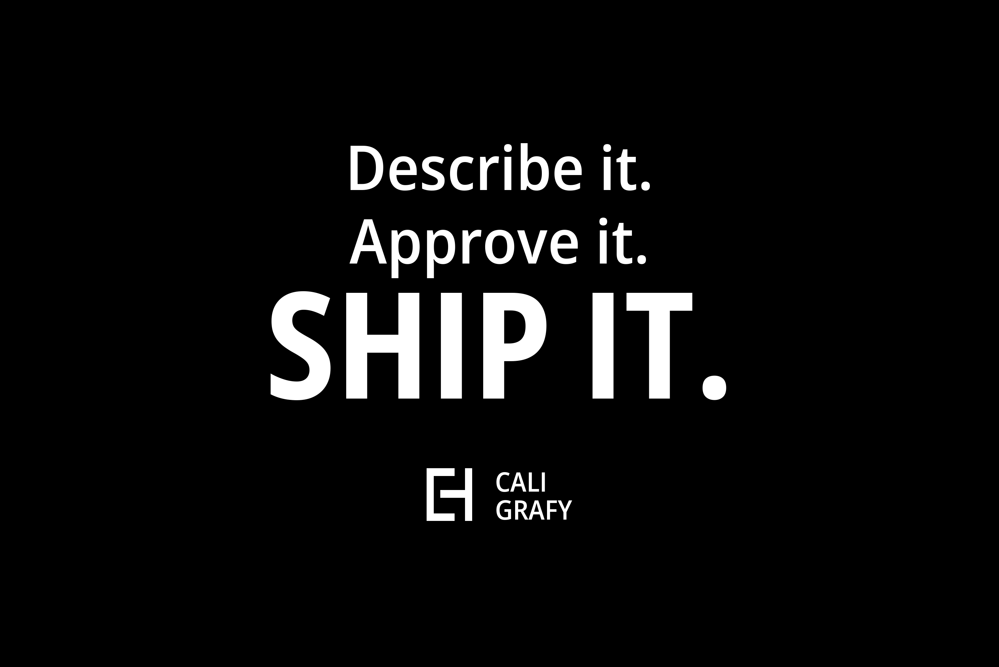

# 10. Claude Code Plugin

> Source: Caligrafy Quill wiki - https://github.com/caligrafy/caligrafy-quill/wiki/10.-Claude-Code-Plugin
> Bundled with the caligrafy-quill Claude plugin. Content preserved from the wiki; formatting cleaned.



Caligrafy Quill ships with its own **[Claude Code](https://code.claude.com) plugin**. When you open a Quill project in Claude Code, Claude knows the framework inside out: routes, controllers, models, relationships, validation, Pug views, the REST API, authentication, payments, Vue apps, bots, FaceDetect, machine learning and the OpenAI/Groq integrations.

With it, Caligrafy is **Describe it. Approve it. Ship it.**: you describe your idea to `/caligrafy-quill:idea`, approve the plan, and Claude builds a complete app and ships it to GitHub and Caligrafy Cloud. Along the way it follows the Caligrafy way, **build once, experience everywhere**: asked for a feature that pages, Vue apps, an API or AI agents need, Claude writes it once as a capability (`/caligrafy-quill:new-capability`) and wires every experience to it.

The plugin lives in the [`claude-plugin/`](https://github.com/caligrafy/caligrafy-quill/tree/master/claude-plugin) folder of the Caligrafy Quill repository.

## What the plugin gives Claude

| Component | Name | What it does |
| - | - | - |
| Skill (automatic) | `caligrafy` | The complete Caligrafy documentation (every page of this wiki), a source-verified API reference, a list of verified gotchas, security notes and documentation errata, and end-to-end recipes for OpenAI/Groq chat apps and face login. Loads automatically whenever Claude works in a Quill project, and UI guidelines so every new page is built with the page components |
| Command | `/caligrafy-quill:idea` | Describe it. Approve it. Ship it. Your idea turned into a complete app online, with one confirmation: plans it with you, builds every feature once, checks every experience, then ships it to GitHub and Caligrafy Cloud by itself ([Quickstart with Claude](https://github.com/caligrafy/caligrafy-quill/wiki/Quickstart-with-Claude)) |
| Command | `/caligrafy-quill:ship` | Puts the project online without handing you work: the GitHub repository (SSH, HTTPS or a browser approval), the Caligrafy Cloud sign-in approved in your browser, the deploy key, the deploy and the check |
| Command | `/caligrafy-quill:marketplace` | Packages an app online on Caligrafy Cloud for the marketplace of caligrafy.com: reads the whole code, runs the app and screenshots its key features, writes the title, description, the prompt that recreates it and an estimated price in one private file, then sends it to Caligrafy (`cloud submit`) and redeploys the app. You earn 25% of every sale |
| Command | `/caligrafy-quill:new-capability` | Builds a feature once as a capability and serves it to every experience: the service, its REST routes, the JS client for Vue apps, a Pug page, MCP for AI agents and a token, then checks that every channel answers and refuses the same way |
| Command | `/caligrafy-quill:new-resource` | Creates the SQL script, the Model, the CRUD capabilities, their REST routes and pages with `Route::page` for a new entity (no controller on the model) |
| Command | `/caligrafy-quill:new-app` | Scaffolds a client app with Caligrafer (Vue as a library, Vue SPA, bot, face detection or machine learning) and wires its routes |
| Command | `/caligrafy-quill:design` | Restyles every page to match a design style (`DESIGN_STYLE`, a `DESIGN.md` of `framework/design/` or `application/design/`): one override stylesheet, checked in a browser at desktop and phone width; `off` brings the Caligrafy look back |
| Command | `/caligrafy-quill:server` | Starts, stops or checks the Docker development server after checking ports and `.env` |
| Command | `/caligrafy-quill:db` | Runs your `create_db.sql` scripts in the MySQL container (or a local MySQL) and inspects tables |
| Command | `/caligrafy-quill:deploy` | Puts the project online: checks it is ready (Dockerfile, `composer.lock`, no secrets in git, database scripts safe to run again, pushed to GitHub), then deploys it to Caligrafy Cloud or prepares it for your own server |
| Command | `/caligrafy-quill:update` | Updates the project to the latest Caligrafy release with `php caligrafer.php update`, then merges each `.caligrafy-new` file into your version and checks the project |
| Agent | `caligrafy-reviewer` | Reviews your Caligrafy code against the framework's real behavior |
| Hook | `php -l` | Syntax-checks every `.php` file Claude writes or edits (skipped when PHP is not installed) |

The plugin also knows the Caligrafer maintenance commands and uses them: `php caligrafer.php doctor` (read-only health check of the project, its keys and its services) to diagnose problems first, and `php caligrafer.php upgrade` to bring an existing project up to date with the framework templates.

Current version: **1.28.3**, for Caligrafy Quill v2.16.3. The [plugin changelog](https://github.com/caligrafy/caligrafy-quill/blob/master/claude-plugin/README.md#changelog) lists what each version added: the library upgrade (1.2), FaceDetector camera control (1.3), AI chat and face login recipes and Docker troubleshooting (1.4), real HTTP status codes (1.4.1), `upgrade` (1.5), namespaced controllers (1.6), the explicit layout classes (1.7), `doctor` (1.8), the PHPUnit unit tests of the framework core in the QA suite (1.8.1), install to home screen, face login liveness and passkeys, and open-model providers such as Llama on OpenRouter or Ollama (1.9), the release notes and Testing Caligrafy pages (1.9.1), versioned releases with `php caligrafer.php version` (1.10), the build-once layer: capabilities, tokens, MCP and the `new-capability` command (1.11), the `application/services/` folder in every new project (1.11.1), `framework/interfaces/` (1.11.2), UI guidelines so every new page is built with the page components (1.12), the one-command `quickstart` (1.13), one card per page, Vue apps on the JS client and the SPA router settings (1.13.1), the fix for the `npm install` vulnerabilities of Vite apps (1.13.2), `caligrafer call` with the new upgrade reports (1.14), putting a project online with the `deploy` command (1.15), the Quickstart with Claude, `/caligrafy-quill:idea` (1.16), only capabilities touch models with `Route::page` and capabilities-first resources (1.17), the Composer quickstart on local servers (1.18), shipping without hand-offs with `/caligrafy-quill:ship` (1.19), and selling an app on the marketplace with `/caligrafy-quill:marketplace` (1.25). The [Release notes: October 2026](https://github.com/caligrafy/caligrafy-quill/wiki/Release-notes:-October-2026#plugin) map each version to the framework change it follows.

## Installing the plugin

### Automatic (recommended)
Every Quill project ships a `.claude/settings.json` that registers the plugin's source (its "marketplace") and enables the plugin. Since 2.10.1 `initialize` (and so `quickstart`) gives that source the project's own name, `caligrafy-<folder>-<4 letters>`, and `quickstart` registers it with Claude Code when the `claude` command is on your computer. Create or clone a Quill project, set it up, open it in Claude Code and accept the **"trust this folder"** prompt:

```bash
composer create-project caligrafy/caligrafy-quill my-app
# or: git clone https://github.com/caligrafy/caligrafy-quill.git my-app

cd my-app
claude
```

### Manual
From any Claude Code session:

```
/plugin marketplace add caligrafy/caligrafy-quill
/plugin install caligrafy-quill@caligrafy
```

Or from your terminal:

```bash
claude plugin marketplace add caligrafy/caligrafy-quill
claude plugin install caligrafy-quill@caligrafy
```

> The marketplace is named `caligrafy` and the plugin `caligrafy-quill`, which is why the install target is `caligrafy-quill@caligrafy`.

### When a command such as `/caligrafy-quill:design` is unknown
Claude Code keeps one plugin source per name for the whole computer. Before 2.10.1 every project named its source `caligrafy`: the first project opened won, every other project got that project's plugin (an older one, without the newer skills), and none got any once that folder was deleted. In the project, run:

```bash
php caligrafer.php plugin
```

It gives the project's source its own name, registers it with Claude Code and installs the plugin for the project (`claude plugin marketplace add`, `claude plugin install ... --scope project`). Then restart `claude` in the folder. `php caligrafer.php doctor` warns when a project still shares the name or its plugin is read from another folder; `php caligrafer.php update` renames it too.

### When a new skill is missing after an update
Claude Code does not run the project's `claude-plugin/` folder itself: it runs a copy it made when the plugin was installed. Since 2.13.1, `php caligrafer.php update` and `php caligrafer.php plugin` refresh that copy when the project's plugin is newer (`claude plugin marketplace update`, `claude plugin update ... --scope project`), and `doctor` warns while it is older. When the update ran in Docker, where `claude` is not installed, run `php caligrafer.php plugin` on your computer in the project's folder. Then restart `claude` in the folder.

## Commands

### `/caligrafy-quill:idea <your idea>`
The Quickstart with Claude. Describe an application in a sentence or two; Claude takes it through every step of Caligrafy: it sets the project up, proposes a plan (a name, the tables, the capabilities, who may read and change what, the pages, sample data) and waits for your OK, builds each feature once with sign-in and a page for creating tokens for AI agents, checks every capability from the command line, REST and MCP, shows you the application locally, then ships it with `/caligrafy-quill:ship`: your private GitHub repository and `https://<name>.caligrafy.com`. It asks you once, at the plan: your OK covers setting the project up (the framework's `.git` makes way for your app's), the repository and the deploy. After that it does the work; you only approve sign-ins in the browser pages it opens, and say yes before credits are spent. See [Quickstart with Claude](https://github.com/caligrafy/caligrafy-quill/wiki/Quickstart-with-Claude).

```
/caligrafy-quill:idea A reading list: I add books I want to read, mark them as read, and rate them from 1 to 5.
```

### `/caligrafy-quill:new-capability <capability_name> [scope]`
Builds a feature once and serves it everywhere (learn more in [11. Build Once](https://github.com/caligrafy/caligrafy-quill/wiki/11.-Build-Once:-Services,-Capabilities-and-MCP)): scaffolds the service with `php caligrafer.php service`, fills its rules and its work, wires the channels you need (REST routes, the JS client for your Vue apps, a Pug page, MCP for AI agents), creates a token for agents when needed, and checks that every channel answers and refuses the same way.

```
/caligrafy-quill:new-capability create_book books:write
```

### `/caligrafy-quill:new-resource <Entity> [field:type ...]`
Scaffolds a complete resource, capabilities first (learn more about [Models](https://github.com/caligrafy/caligrafy-quill/wiki/4.-Models) and [capabilities](https://github.com/caligrafy/caligrafy-quill/wiki/11.-Build-Once:-Services,-Capabilities-and-MCP#service)):
+ `application/models/<Entity>/create_db.sql`: the MySQL table, with an `id` primary key, `<model>_id` foreign keys and unique constraint names
+ `application/models/<Entity>/<Entity>.php`: the `Model` with one public property per column
+ the CRUD capabilities in `application/services/<Entities>/` (list, get, create, update, delete), the only code that touches the model
+ their REST routes (`Route::capability`) and the pages (`Route::page` with their data from the capabilities) in `application/config/routing/web.php`

Field types: `string`, `text`, `int`, `decimal`, `bool`, `date`, `datetime`, `json`. Use `name:fk` for a foreign key to the model `Name`.

```
/caligrafy-quill:new-resource Book title:string author:string publisher:fk
```

### `/caligrafy-quill:new-app <app | create | bot | facedetect | ml> <name>`
Scaffolds a client app in `public/<name>` using Caligrafer and wires its page and data routes (learn more about [Vue as a library](https://github.com/caligrafy/caligrafy-quill/wiki/9.7.0-Setting-up-Vue.js-as-a-library), the [Vue SPA](https://github.com/caligrafy/caligrafy-quill/wiki/9.8.1---Setting-up-the-Vue-application), [Bots](https://github.com/caligrafy/caligrafy-quill/wiki/9.9.1-Creating-Bots-with-Watson), [FaceDetect](https://github.com/caligrafy/caligrafy-quill/wiki/9.9.2-Face-Detection-and-Face-Recognition) and [Machine Learning](https://github.com/caligrafy/caligrafy-quill/wiki/9.9.3-Machine-Learning)).

+ `app`: Vue 3 as a library (default)
+ `create`: Vite Vue SPA with Vue Router and Pinia (requires Node.js 20.19+ or 22.12+)
+ `bot`: IBM Watson bot
+ `facedetect`: face detection and recognition
+ `ml`: ML Core (ml5 and p5)

For two common projects the plugin carries complete recipes that Claude follows:
+ **AI chat apps**: an OpenAI chat or an open model chat (Groq, or Llama on OpenRouter or a local Ollama) with the conversation history, live model lists, image generation and image analysis, behind your own controller and a Vue chat page (learn more about [OpenAI](https://github.com/caligrafy/caligrafy-quill/wiki/9.9.4-OpenAI:-ChatGPT,-GPTs,-DALL.E) and [open source agents](https://github.com/caligrafy/caligrafy-quill/wiki/9.9.6-Open-Source-Agents-(llama,-Mistral-etc.)))
+ **Face login**: enrolment and login with FaceDetector face prints, encrypted in the database and compared on the server, with a lockout after repeated failures. Face prints have no liveness check (a photo can pass): use face login as a convenience or a second factor, not as the only protection

App names cannot use the reserved folder names `app`, `bot`, `__bots__`, `css`, `facedetect`, `fonts`, `images`, `js`, `ml`, `resources` and `uploads`.

```
/caligrafy-quill:new-app facedetect faceauth
```

### `/caligrafy-quill:design [style | off]`
Gives the application the look of a [design style](https://github.com/caligrafy/caligrafy-quill/wiki/Design-Styles): one of the `DESIGN.md` files of `framework/design/` (84 from VoltAgent/awesome-design-md, local ones such as `interstellar`), or your own in `application/design/`. Claude reads the whole `DESIGN.md`, writes one stylesheet, `public/css/designs/<style>.css`, loaded after the Caligrafy stylesheets (tokens, layout, sign-in pages, buttons, fields and every page component), sets `DESIGN_STYLE` in `.env`, then checks the sign-in pages and your pages in a browser at desktop and phone width. Caligrafy's own files and your views are never edited: `/caligrafy-quill:design off` (or `php caligrafer.php design off`) brings the Caligrafy look back. Without a style, it asks which one, with a few suggestions.

```
/caligrafy-quill:design linear.app
```

### `/caligrafy-quill:server <start | stop | status>`
Runs the Docker development server through `.bin/caligrafer` (app on `8080`, phpMyAdmin on `8077`, MySQL on `3306`). Before starting, it checks that Docker is running, that those ports are free (and proposes remapping them if they are not) and that `.env` has the Docker settings (`DB_HOST=mysql`, an empty `APP_ROOT`). It also knows how to remap ports with a `docker-compose.override.yml` and how to fix PHP requests that fail behind a corporate TLS inspection proxy ("self-signed certificate in certificate chain") by giving the container the corporate root certificate. Learn more about [Using Docker](https://github.com/caligrafy/caligrafy-quill/wiki/1.-Getting-Started#using-docker).

```
/caligrafy-quill:server start
```

When something does not work (database connection, API keys, models not available to a key, TLS errors behind a corporate proxy), the skill runs `php caligrafer.php doctor` first, then follows its troubleshooting notes: port clashes with a `docker-compose.override.yml`, and the corporate root certificate mounted into the Docker container when PHP cannot reach a service that the computer itself reaches.

### `/caligrafy-quill:ship [app-name] [--public]`
Puts the project online and does every step itself. It commits the work, then creates the GitHub repository (private unless `--public`) and pushes it: with your SSH key when GitHub knows it, else over HTTPS with the GitHub CLI, else it installs and signs in the GitHub CLI with a code you approve on the GitHub page it opens. It signs in to Caligrafy Cloud the same way, with a code you approve on deploy.caligrafy.com (sign up there the first time). Then it creates the app, adds its read-only deploy key to the repository, deploys, and checks the address answers. It never asks you to run a command or copy a token, and asks before spending credits (every new app is free for its first 30 minutes online). Use it again after a change: it pushes and redeploys.

```
/caligrafy-quill:ship myapp
```

### `/caligrafy-quill:marketplace [app-name]`
Packages an app hosted on Caligrafy Cloud for the [marketplace of caligrafy.com](https://github.com/caligrafy/caligrafy-quill/wiki/Putting-it-Online#marketplace), after you offered it on its page in the App console. It reads the whole code; runs the app on your computer as a separate Docker project (its own free ports, a throwaway database) and walks through it with invented sample data to screenshot its key features, 5 at most, all different (a camera app sees a realistic picture or clip instead of a test pattern); writes the title, the description, the prompt that recreates the whole app with Caligrafy and an estimated price window from a short market study, in one private file, `.caligrafy/marketplace.json`; then sends it with `php caligrafer.php cloud submit` and redeploys the app. It takes a while, often 15 to 30 minutes, and never reads your Cloud token or puts a secret in the file.

```
/caligrafy-quill:marketplace myapp
```

### `/caligrafy-quill:deploy [app-name] [--own-server]`
Puts the project online. It first checks, without changing anything, that the project is ready: Caligrafy Quill 2.4.0 or later with its `Dockerfile`, `composer.lock` committed, no `.env` or keys in git, `create_db.sql` scripts that are safe to run at every start, and everything committed and pushed to GitHub. Then it deploys to [Caligrafy Cloud](https://github.com/caligrafy/caligrafy-quill/wiki/Putting-it-Online#cloud) with `php caligrafer.php cloud`: it creates the app, shows the deploy key of a private repository for you to add on GitHub, and follows the build until `https://<name>.caligrafy.com` answers. `php caligrafer.php cloud login` is approved in your browser (2.7.0+): Claude never asks for the token or a secret, and asks before spending credits or deleting. To ship without any hand-off, use `/caligrafy-quill:ship`. With `--own-server` it prepares the project for [Coolify or Docker](https://github.com/caligrafy/caligrafy-quill/wiki/Putting-it-Online#ownserver) instead.

```
/caligrafy-quill:deploy myapp
```

### `/caligrafy-quill:update [version]`
Updates the project to the latest release of Caligrafy Quill, or to the one you name. It shows what [`php caligrafer.php update`](https://github.com/caligrafy/caligrafy-quill/wiki/Caligrafer#update) will change, applies it, then goes through every `.caligrafy-new` file: it keeps your changes, takes the release's, and tells you what it chose where both rewrote the same lines. It ends with `doctor`, the release notes of each version passed, and a commit with your OK. A project before 2.9.0 gets the command first.

```
/caligrafy-quill:update
```

### `/caligrafy-quill:db <script.sql | tables | query "SQL">`
Runs SQL against the project's MySQL: inside the Docker `mysql` container, or a local MySQL using the `DB_*` settings of `.env`.
+ `<script.sql>`: runs a script such as `application/models/Book/create_db.sql`. Scripts that contain `DROP`, `TRUNCATE` or `DELETE` are checked first and need your confirmation
+ `tables`: lists the tables with their row counts
+ `query "SQL"`: runs read-only queries; Claude asks before any statement that writes

```
/caligrafy-quill:db application/models/Book/create_db.sql
```

## The `caligrafy-reviewer` agent
The reviewer checks your controllers, models, routes, Pug views, SQL scripts and Vue clients for framework-specific bugs and security issues: SQL built from user input, CSRF and API header mistakes, `check()` misuse, route fallbacks, unsafe uploads, `constant()` fed with user input, authentication and client-app templates older than the framework, Vue 2 syntax in Vue 3 apps, foreign key and pivot schema problems, and exposed secrets. It only reviews and never edits your files. Ask for it in plain language:

```
> Review my BookController with the caligrafy-reviewer agent
```

## Try it
A typical first session:

```
/caligrafy-quill:server start
/caligrafy-quill:new-resource Book title:string author:string publisher:fk
/caligrafy-quill:db application/models/Book/create_db.sql
/caligrafy-quill:new-app facedetect faceauth
> Add login with the Caligrafy authentication module and protect /books with guard()
> Review my BookController with the caligrafy-reviewer agent
```

## How the plugin's knowledge is maintained
+ `skills/caligrafy/reference/0*.md`, `1*.md` and `wiki-sidebar.md` mirror the pages of this wiki (including the release notes and Testing Caligrafy), with a link to the source page at the top of each. They are refreshed with `python3 claude-plugin/scripts/sync-wiki.py <wiki clone>` (`--check` reports stale mirrors).
+ `api-reference.md` and `gotchas.md` are written from the framework source. When the two disagree, the source-verified files take precedence over the wiki.
+ When `framework/` changes, these files need to be updated, the [QA suite](https://github.com/caligrafy/caligrafy-quill/wiki/Testing-Caligrafy#qa) run (`./qa/run.sh`, which also runs the PHPUnit unit tests in `qa/unit` with `vendor/bin/phpunit`) and the `version` in `claude-plugin/.claude-plugin/plugin.json` bumped (see the [release process](https://github.com/caligrafy/caligrafy-quill/wiki/Testing-Caligrafy#release)). Claude also knows that projects created with an older framework keep older copies of the authentication module and client-app files in `application/` (see [Upgrading an existing project](https://github.com/caligrafy/caligrafy-quill/wiki/9.5-Security-and-Upgrading#upgrading)).

For plugin development, load it locally with `claude --plugin-dir ./claude-plugin` and validate it with `claude plugin validate ./claude-plugin --strict`.

> **Safety notes**
> + `php caligrafer.php initialize` deletes the `.git` folder. Claude asks before running it in a git repository.
> + Claude never prints or commits the secrets in your `.env` file.

**This is the end of the documentation and the beginning of your journey!**
